

  

  
  
  
  
  
  
  
  
  
  
  



  
  &nbsp;&nbsp;
  
  &nbsp;&nbsp;
  
  &nbsp;&nbsp;
  
  &nbsp;&nbsp;
  
  &nbsp;&nbsp;
  
  &nbsp;&nbsp;
  
  &nbsp;&nbsp;
  

  
  
  
  
  


<!-- Project 1: Skyward -->
<a href="https://trackyourflight.lakshya.uk"></a>

  
  

<!-- Project 2: Locate Art -->
<a href="https://locate.art.lakshya.uk"></a>

  
  

<!-- Project 3: Craftme -->
<a href="https://craftme.lakshya.uk"></a>

  
  
  

<!-- Project 4: TODAR -->
<a href="https://todar.finance.lakshya.uk"></a>

  
  
  


<a href="https://lak-is-law.github.io/lak-is-law/"></a>

  



  
  
  
  
  
  

  
  

