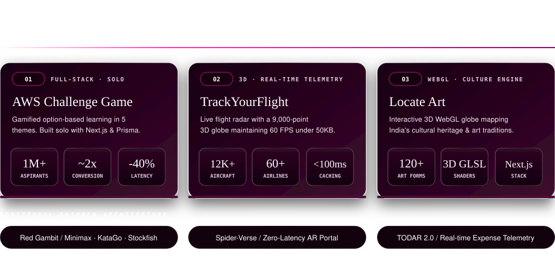
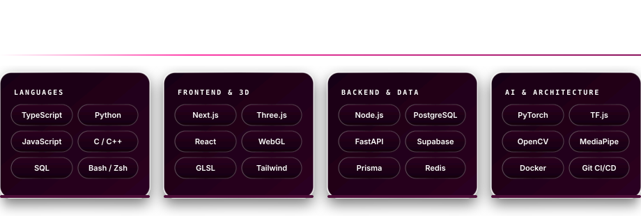
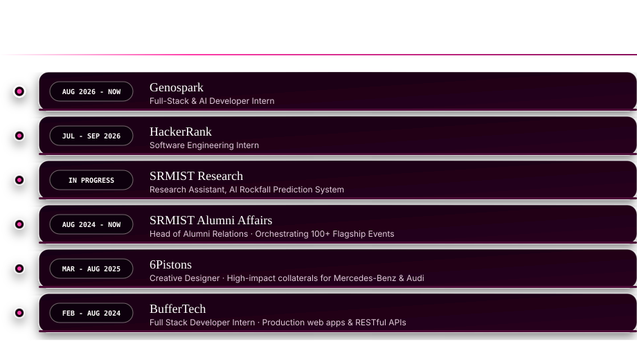
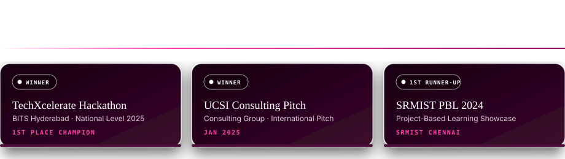

<!-- 3D HERO HEADER -->

  

<!-- 3D LUXURY NAVIGATION DOCK -->

&nbsp;

&nbsp;

&nbsp;

&nbsp;

  

<!-- 3D SELECTED PRODUCTION WORK -->

  

<!-- 3D ENGINEERING TOOLKIT -->

  

<!-- 3D EXPERIENCE & TRAJECTORY -->

  

<!-- 3D HONORS & RECOGNITION -->

  

<!-- SECTION: 3D CONTRIBUTION TELEMETRY -->

  

    
  

  

    
  

  

    
    &nbsp;
    
  

 

Crafted with high-precision 3D vector shaders &amp; luxury typography · 2026

